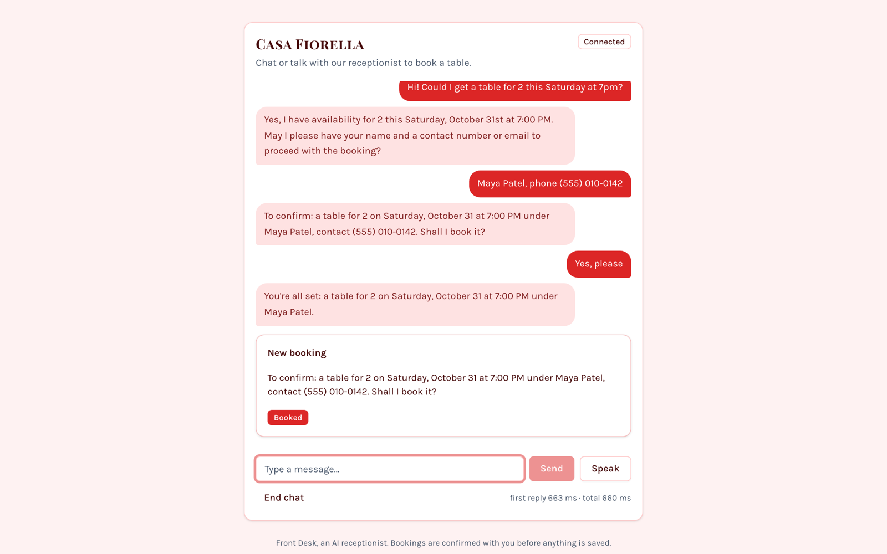
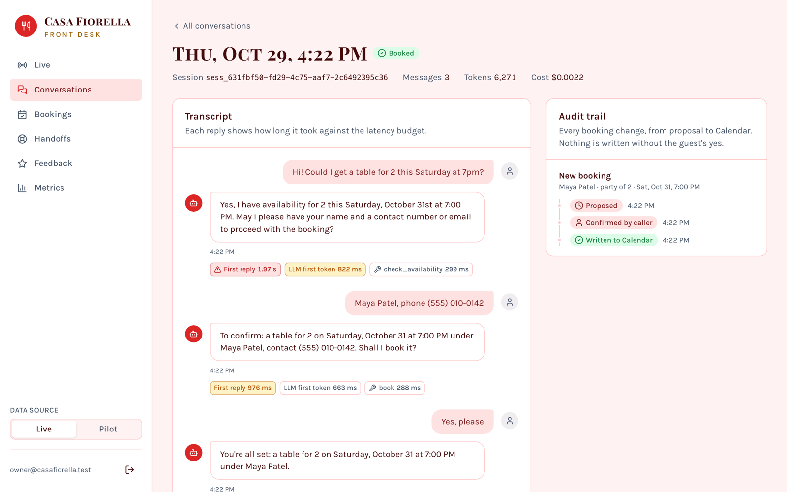
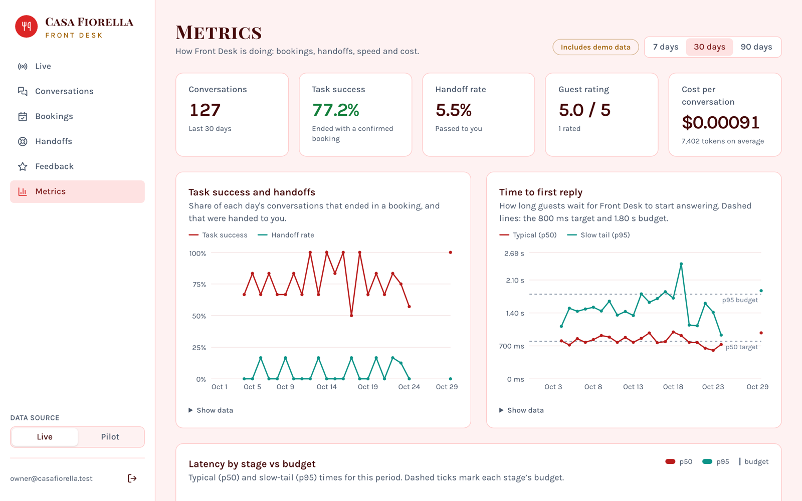
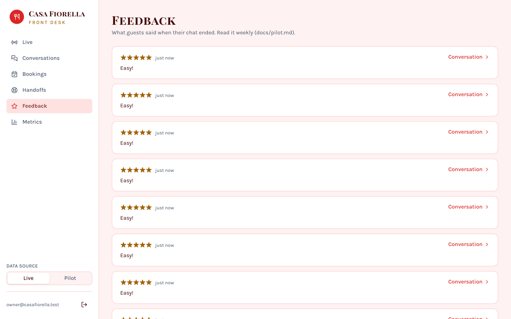
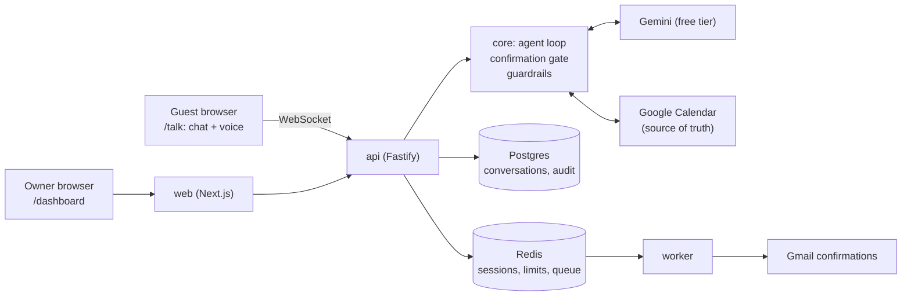

# Front Desk

**A voice AI receptionist that books real restaurant tables, and never writes to the calendar without the guest's explicit "yes".**

🎬 **Demo video:** coming soon · 🌐 **Live demo:** coming soon (see [status](#status-what-works-today)) · Built end to end by Rishabh Srinivasan

Small restaurants lose bookings because nobody can answer the phone during service, and the calls they do answer are the same five questions over and over. Front Desk takes that load: guests talk (or type) to it in the browser, it checks real availability, books, reschedules and cancels in Google Calendar, emails a confirmation, and hands anything tricky to a human. The demo business is **Casa Fiorella**, a fictional family trattoria. Everything runs on free tiers ($0).


<sub>A real run: Gemini on the free tier, a real Google Calendar event, recorded with Playwright. [Full video (mp4)](docs/media/demo.mp4)</sub>

## Highlights

- **Code-enforced confirmation.** The model can only _propose_ a booking. A separate gate reads it back, waits for the guest's yes, re-checks the slot under a lock, and only then writes to Calendar. A test walks every 2-step message sequence, and no write is ever reachable without a confirm.
- **Evaluated like a product:** 100 scripted-caller scenarios across 11 categories (bookings, reschedules, prompt injection, angry callers, policy edge cases).
  - **95.0%** task success
  - **97.0%** correct handoffs
  - **0** unsafe actions

  CI replays them with no API keys and fails on any regression.

- **Owner dashboard.** The home page is the restaurant's day as a calendar, one column per table, read from Google Calendar, with who is talking to Front Desk right now. Handoffs are cards that say who the guest is, what they wanted and what to do next. Metrics answer three questions: is it doing the job, what does it cost (paid-price estimate vs. the $0 actually spent), and how fast is it. Transcripts show per-turn latency and an append-only audit trail. Real pilot data is kept apart from demo and eval data.
- **Voice.** Browser speech-to-text and text-to-speech, sentence streaming and barge-in.
- **Built for strangers:**
  - per-IP and per-session rate limits, and a Cloudflare Turnstile bot check
  - booking and email caps that `+tags` can't dodge
  - a 30-day retention job that redacts personal data
  - no personal data in logs (tested)
  - a production guard that refuses any paid setting
- **$0 to run:** Gemini free tier with a hard spend cap of 0, and an Oracle Always Free VM behind Caddy (automatic HTTPS).

| Guest chat                                                    | Owner: one conversation, its latency and audit trail                              |
| ------------------------------------------------------------- | --------------------------------------------------------------------------------- |
|  |  |
| **Owner: metrics**                                            | **Owner: guest feedback**                                                         |
|      |                             |

## Status: what works today

| Area                                                               | State                                                                                                   |
| ------------------------------------------------------------------ | ------------------------------------------------------------------------------------------------------- |
| Book, reschedule, cancel, change party size, FAQ, human handoff    | ✅ Implemented and tested (unit, e2e, 100-scenario evals)                                               |
| Browser voice: speech in, speech out, sentence streaming, barge-in | ✅ Implemented (Chrome, Edge, Safari; other browsers fall back to chat)                                 |
| Real Google Calendar writes and Gmail confirmations                | ✅ Implemented, against a demo calendar                                                                 |
| Owner dashboard, audit trail, per-turn latency, feedback           | ✅ Implemented                                                                                          |
| Abuse limits, bot check, PII retention, production guard           | ✅ Implemented                                                                                          |
| Production stack (Docker, Caddy, HTTPS)                            | ✅ Built and run end to end; public hosting waiting on Oracle free-tier capacity                        |
| Phone calls (a real number)                                        | ❌ Not built. Voice is in the browser only. Telephony is the next step (the STT/TTS layer is swappable) |
| A real restaurant using it                                         | ❌ Not yet. All bookings land on a demo calendar                                                        |
| Premium speech (Deepgram) and a smarter endpointer                 | 🔜 Planned                                                                                              |

## The voice engineering

Voice is the part of this I care about most, and most of the hard problems are about turn-taking, not the model:

- **Endpointing.** Deciding when the guest has finished talking. Chrome's built-in endpointing ends the turn at the first pause, which cuts people off at "a table for… four". Front Desk listens continuously and runs its own silence timer, and tapping the mic sends immediately for people in a hurry. The trade-off (snappy vs. not cutting people off) is written up in [docs/learning/m7-voice.md](docs/learning/m7-voice.md).
- **Barge-in that's safe.** Guests talk over the receptionist. Speaking mutes the reply and cancels the server's turn at the next safe point. If a confirmed booking was already being written, it is _not_ cancelled half-way, and what the guest said over the read-back is never taken as a "yes".
- **Streaming by sentence.** The first sentence is spoken while the rest is still being generated.
- **Measured, not guessed.** Every turn records STT, time to first token, tool time, TTS start and total against a latency budget, and the dashboard flags slow turns. On local runs with Gemini's free tier, real turns came in at about **1.5 s median, 2.5 s p95** to a full reply, with the first words in under a second (≈500 turns of my own testing, not real guests).

## Key technical decisions

- **The model proposes, code disposes.** Tools that write (book, move, cancel) only create a _pending action_. A deterministic gate reads it back in plain words, and only an unambiguous "yes" executes it, after re-checking the slot under a lock. An exhaustive test walks every two-message sequence to prove no write is reachable without a confirm.
- **Calendar is the source of truth.** No shadow bookings table to drift out of sync; availability is computed from Calendar plus the business config.
- **Untrusted text stays untrusted.** The guest's words are fenced as data in the prompt, never instructions, and the gate makes injected "it's already confirmed" tricks inert. Before a reply goes out, every time, date, price and number in it must come from the business config, a tool result, or the guest's own words (grounding check). Prompt-injection scenarios are part of the eval suite.
- **Evals gate CI.** Recorded conversations replay with no API keys, so every PR is checked against the same 100 scenarios.
- **Swappable providers.** The LLM, speech-to-text and text-to-speech all sit behind interfaces, so moving to a paid model, Deepgram, or a phone line doesn't touch the agent.

## How it's built



- **Design:** [docs/superpowers/specs/2026-10-22-frontdesk-design.md](docs/superpowers/specs/2026-10-22-frontdesk-design.md).
- **Learning notes:** one per milestone, with reading order, concepts and a quiz, in [docs/learning/](docs/learning/).

## Prerequisites

- Node 24 (`.nvmrc`)
- pnpm 10, via `corepack enable`
- Docker (for Postgres and Redis)

## Quickstart

```bash
pnpm install
cp .env.example .env
pnpm infra:up      # postgres on :54320, redis on :63790
pnpm verify        # lint, format check, typecheck, unit tests (no Docker needed)
pnpm test:infra    # smoke tests against the running containers
```

Host ports are non-standard on purpose so they don't clash with a local Postgres or Redis. Change `POSTGRES_PORT` / `REDIS_PORT` and the URLs in `.env` if you need different ones.

If `frontdesk_eval` is reported missing, your Postgres volume predates the init script. Recreate it with `docker compose down -v && pnpm infra:up` (this deletes local data).

## Workspace

| Path                    | Purpose                                                                                                        |
| ----------------------- | -------------------------------------------------------------------------------------------------------------- |
| `apps/api`              | Fastify: WebSocket sessions, agent loop host, owner REST + live feed                                           |
| `apps/worker`           | BullMQ jobs: confirmation emails, retries, metric rollups                                                      |
| `packages/core`         | Pure domain: config, availability, agent loop, tools, confirmation gate, guardrails. No I/O (enforced by lint) |
| `packages/llm`          | LLM provider interface, providers, and cache / rate-limit / retry / spend-cap wrappers                         |
| `packages/integrations` | Google Calendar and Gmail adapters                                                                             |
| `packages/db`           | Drizzle schema and migrations                                                                                  |
| `packages/evals`        | Scenario simulator, scorer, `pnpm eval` scoreboard                                                             |

`apps/web` is the Next.js caller widget (`/talk`) and owner dashboard (`/dashboard`).

## Pilot and deploy

Front Desk is ready to run as a public pilot on an Oracle Cloud Always Free VM behind Caddy (automatic HTTPS), at $0. The production stack (`deploy/compose.prod.yml`) has been built and run end to end; going live is waiting on Oracle free-tier capacity. See:

- [docs/deploy.md](docs/deploy.md): setup and deploys
- [docs/pilot.md](docs/pilot.md): the weekly routine, and comparing real numbers with the evals
- `pnpm release`: tags the weekly `vYYYY.MM.DD` release
- `pnpm smoke <url>`: checks a deployed site without spending any LLM quota
