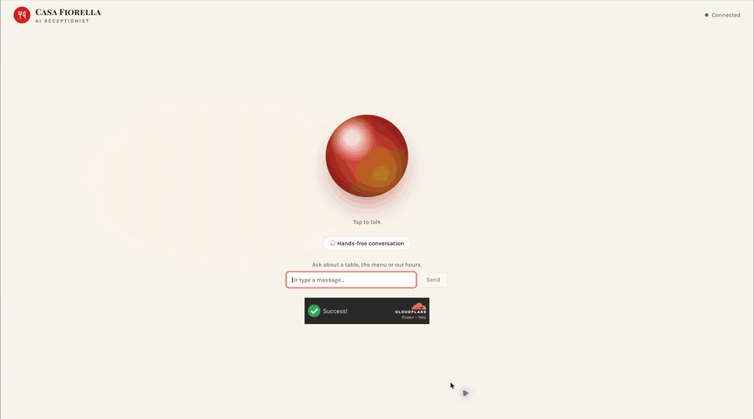
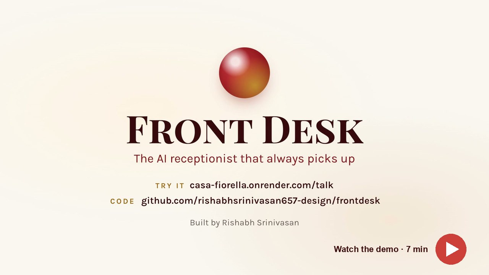
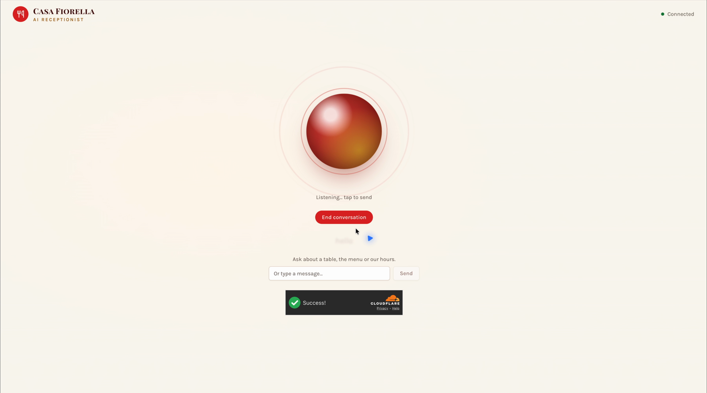
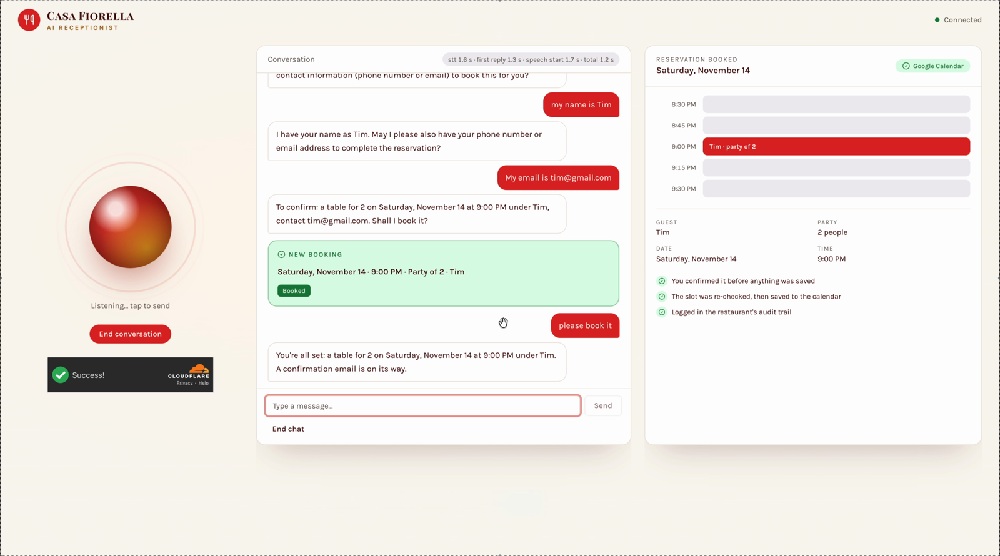
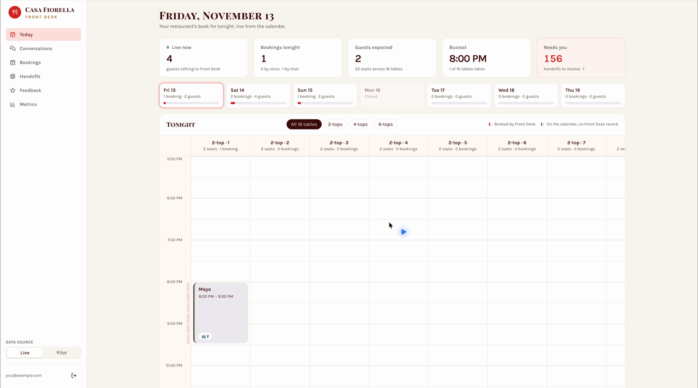
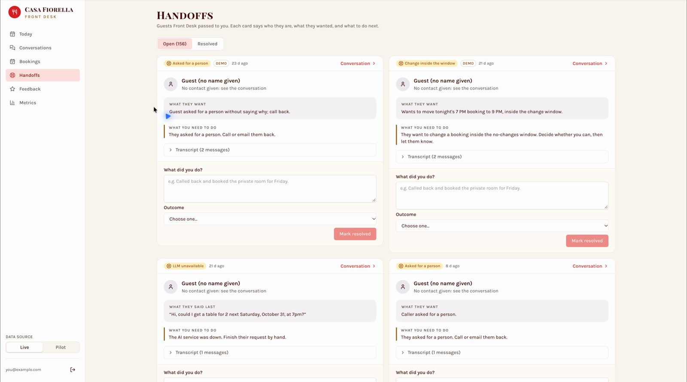
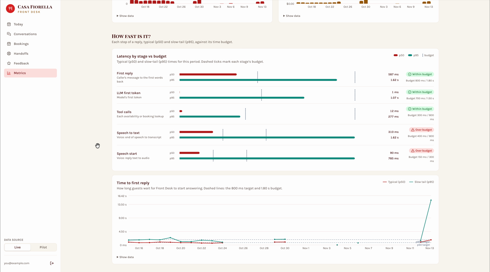
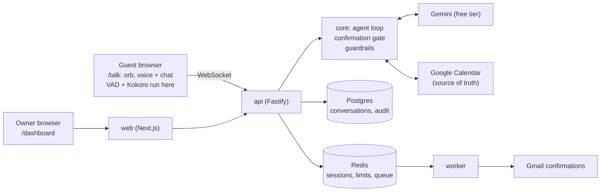

# Front Desk

**A voice AI receptionist that books real restaurant tables, and never writes to the calendar without the guest's explicit "yes".**

🎬 **[Watch the demo video](#demo-video)** · 🌐 **Live demo:** [casa-fiorella.onrender.com/talk](https://casa-fiorella.onrender.com/talk) ([status](#status-what-works-today)) · Built end to end by Rishabh Srinivasan

Small restaurants lose bookings because nobody can answer the phone during service, and the calls they do answer are the same five questions over and over. Front Desk takes that load: guests **talk** (or type) to it in the browser, it checks real availability, books, reschedules and cancels in Google Calendar, emails a confirmation, and hands anything tricky to a human. The demo business is **Casa Fiorella**, a fictional family trattoria. Everything runs on free tiers ($0).



<sub>A real run (sped up 3×): Gemini on the free tier, a natural voice running in the browser, and a real Google Calendar event.</sub>

## Demo video

[](https://youtu.be/md3PwHh_4NE)

_A 7-minute walkthrough recorded on the live site: booking a table by voice, interrupting it mid-sentence, moving a booking, a party of 20 handed to the team, the owner's dashboard, and what's under the hood. Long pauses are trimmed and some parts are sped up; the on-screen chip says by how much._

## Highlights

- **Voice-first.** Tap the orb, or turn on **hands-free** and just talk. The orb listens, thinks and speaks, a conversation pane slides in, and when a booking is saved a calendar pane shows the slot on the restaurant's evening.
- **Code-enforced confirmation.** The model can only _propose_ a booking. A separate gate reads it back, waits for the guest's yes, re-checks the slot under a lock, and only then writes to Calendar. A test walks every 2-step message sequence, and no write is ever reachable without a confirm.
- **Evaluated like a product:** 100 scripted-caller scenarios across 11 categories (bookings, reschedules, prompt injection, angry callers, policy edge cases).
  - **95.0%** task success
  - **97.0%** correct handoffs
  - **0** unsafe actions

  CI replays them with no API keys and fails on any regression.

- **Owner dashboard.** The home page is the restaurant's day as a calendar, one column per table, read from Google Calendar, with who is talking to Front Desk right now. Handoffs are cards that say who the guest is, what they wanted and what to do next. Metrics answer three questions: is it doing the job, what does it cost (paid-price estimate vs. the $0 actually spent), and how fast is it, stage by stage against a latency budget.
- **Built for strangers:** per-visitor and per-session rate limits, a Cloudflare Turnstile bot check, booking and email caps that `+tags` can't dodge, a 30-day retention job that redacts personal data, no personal data in logs (tested), and a production guard that refuses any paid setting.
- **$0 to run:** Gemini free tier with a hard spend cap of 0, Render's free tier for hosting, and a natural voice that runs in the guest's browser.

| Guest: the orb, listening                           | Guest: booked, with the calendar pane                               |
| --------------------------------------------------- | ------------------------------------------------------------------- |
|        |  |
| **Owner: today, one column per table**              | **Owner: handoff cards**                                            |
|  |                  |



## Status: what works today

| Area                                                            | State                                                                                                                                                                                                                                                     |
| --------------------------------------------------------------- | --------------------------------------------------------------------------------------------------------------------------------------------------------------------------------------------------------------------------------------------------------- |
| Book, reschedule, cancel, change party size, FAQ, human handoff | ✅ Implemented and tested (unit, e2e, 100-scenario evals)                                                                                                                                                                                                 |
| Voice: orb, hands-free, barge-in, natural in-browser voice      | ✅ Implemented (Chrome and Edge are best; Safari works; other browsers fall back to chat)                                                                                                                                                                 |
| Real Google Calendar writes and Gmail confirmations             | ✅ Implemented, against a demo calendar                                                                                                                                                                                                                   |
| Owner dashboard: day calendar, handoffs, metrics, audit trail   | ✅ Implemented                                                                                                                                                                                                                                            |
| Abuse limits, bot check, PII retention, production guard        | ✅ Implemented                                                                                                                                                                                                                                            |
| Public hosting                                                  | ⚠️ Live on Render's free tier. The free services sleep when idle (first load takes about a minute), and chat connections on Render are still being stabilised. If the live demo won't connect, [run it locally](#quickstart): it takes about ten minutes. |
| Phone calls (a real number)                                     | ❌ Not built. Voice is in the browser only. Telephony is the next step (the speech layer is swappable)                                                                                                                                                    |
| A real restaurant using it                                      | ❌ Not yet. All bookings land on a demo calendar                                                                                                                                                                                                          |

## The voice engineering

Voice is the part of this I care about most, and most of the hard problems are about turn-taking, not the model:

- **Endpointing: knowing when the guest has finished.** Chrome's built-in endpointing ends the turn at the first pause, which cuts people off at "a table for… four". Front Desk combines three signals: **Silero VAD** (a ~2 MB neural voice detector running in the browser) hears whether the guest is actually speaking, the **words** set how long to wait ("yes" can be answered at once, "a table for" clearly isn't finished), and the **guest's own habits** stretch the wait for people who pause mid-sentence. If Chrome restarts recognition mid-sentence, the words are stitched back together instead of sent half-finished. See [docs/learning/endpointing.md](docs/learning/endpointing.md).
- **Hands-free and natural barge-in.** Tap once and talk; the mic reopens after each reply. Talking over the receptionist fades its voice at once and only stops it if you keep talking, so a cough or "mm-hm" doesn't cut it off. A confirmed booking that's already being written is never cancelled half-way, and what the guest says over a read-back is never taken as a "yes". See [docs/learning/hands-free.md](docs/learning/hands-free.md).
- **A natural voice for $0.** **Kokoro**, an open-source neural text-to-speech model, runs inside the guest's browser (WebGPU, or WASM). ElevenLabs covers the first seconds while it loads, and the voice is locked for the whole conversation so it never changes mid-call. See [docs/learning/natural-voice.md](docs/learning/natural-voice.md).
- **Covering the slow moments.** If no reply has started 1.2 s after the guest stops, the browser says "one moment", like a person would. It's never sent to the agent, so it can't confirm anything.
- **Streaming by sentence.** The first sentence is spoken while the rest is still being generated, and times are said the way people say them ("nine PM", not "twenty-one hundred").
- **Measured, not guessed.** Every turn records speech-to-text, time to first token, tool time, speech start and total against a latency budget, and the dashboard flags slow stages. On Gemini's free tier, replies come in at about **1.5 s median** to a full reply, with the first words in under a second.

## Key technical decisions

- **The model proposes, code disposes.** Tools that write (book, move, cancel) only create a _pending action_. A deterministic gate reads it back in plain words, and only an unambiguous "yes" executes it, after re-checking the slot under a lock. An exhaustive test walks every two-message sequence to prove no write is reachable without a confirm.
- **Calendar is the source of truth.** No shadow bookings table to drift out of sync; availability is computed from Calendar plus the business config.
- **Untrusted text stays untrusted.** The guest's words are fenced as data in the prompt, never instructions, and the gate makes injected "it's already confirmed" tricks inert. Before a reply goes out, every time, date, price and number in it must come from the business config, a tool result, or the guest's own words (grounding check). Prompt-injection scenarios are part of the eval suite.
- **Evals gate CI.** Recorded conversations replay with no API keys, so every PR is checked against the same 100 scenarios.
- **Swappable providers.** The LLM, speech-to-text and text-to-speech all sit behind interfaces, so moving to a paid model, a hosted speech service, or a phone line doesn't touch the agent.

## How it's built



- **Design:** [docs/superpowers/specs/2026-10-22-frontdesk-design.md](docs/superpowers/specs/2026-10-22-frontdesk-design.md).
- **Learning notes:** one per milestone and feature, with reading order, concepts and a quiz, in [docs/learning/](docs/learning/).

## Prerequisites

- **Node 24** (see `.nvmrc`; `nvm use` picks it up)
- **pnpm 10**, through `corepack enable` (comes with Node)
- **Docker Desktop, running** (Postgres and Redis run in containers)
- **A free [Gemini API key](https://aistudio.google.com/apikey)**: the only key you need
- **Chrome or Edge** for voice. Safari works too; Firefox has no speech recognition, so you can only type there.

## Quickstart

Running it locally takes about ten minutes, and it's the most reliable way to try Front Desk (the free hosted demo sleeps when idle).

**1. Install**

```bash
git clone https://github.com/rishabhsrinivasan657-design/frontdesk.git
cd frontdesk
corepack enable
pnpm install
```

pnpm may warn about "ignored build scripts". That's expected; nothing needs approving.

**2. Configure.** Copy the example settings, then open `.env` and set `GEMINI_API_KEY=` to your key. Leave everything else as it is.

```bash
cp .env.example .env
```

**3. Start the database and cache**

```bash
pnpm infra:up      # Postgres on :54320, Redis on :63790
pnpm db:migrate    # creates the tables
```

**4. Run it, in two terminals**

```bash
pnpm api           # terminal 1: the api on :4000
```

```bash
pnpm web           # terminal 2: the site on :3000
```

**5. Talk to it.** Open <http://localhost:3000/talk> in Chrome, allow the microphone, and tap the orb (or **🎧 Hands-free conversation**) and ask for a table. You can also just type.

Bookings go to an in-memory calendar that resets when the api restarts. That's all you need to try it. The optional extras below add a real calendar, emails and the owner dashboard.

### How the voice is set up

Nothing to install: the voice runs in the browser.

- **Listening:** the browser's built-in speech recognition (in Chrome and Edge it uses the browser's own speech service).
- **Knowing when you've finished talking:** Silero VAD, a 2 MB model that comes with `pnpm install`. `pnpm web` copies it into `apps/web/public/vad` on every start.
- **The natural voice:** Kokoro downloads from Hugging Face the first time you tap the orb, then stays in the browser's cache. It's about **330 MB** where the browser has WebGPU (most recent Chrome and Edge) and about **90 MB** otherwise, so the first download can take a few minutes on a slow connection. Until it finishes, that conversation uses the browser's built-in voice; once it's ready, **End chat** and start again to hear the natural voice. An optional free `ELEVENLABS_API_KEY` in `.env` covers that gap.

### Optional extras

- **Owner dashboard** (<http://localhost:3000/dashboard>): make a password hash, then add `OWNER_EMAIL=you@example.com` and `OWNER_PASSWORD_HASH='<the hash>'` to `.env` (single quotes, because the hash contains `$`). Restart `pnpm api`. To make the hash without your password showing on screen, run:

  ```bash
  read -rs PW && printf %s "$PW" | pnpm owner:hash; unset PW
  ```

  Type a password of at least 12 characters, then press Enter.

- **A real Google Calendar and confirmation emails:** follow [docs/google-setup.md](docs/google-setup.md). Then run the worker in a third terminal; it needs these Google credentials to start:

  ```bash
  pnpm --filter @frontdesk/worker start
  ```

### Checks

```bash
pnpm verify        # lint, format check, typecheck and unit tests (no Docker needed)
pnpm test:infra    # smoke tests against the running containers
pnpm eval          # the scripted conversations (uses your Gemini key)
```

### Troubleshooting

- **`pnpm infra:up` fails:** start Docker Desktop first.
- **A port is already in use:** the host ports are non-standard on purpose so they don't clash with a local Postgres or Redis. Change `POSTGRES_PORT` / `REDIS_PORT` and the URLs in `.env`.
- **The orb says voice isn't available:** use Chrome or Edge, and allow the microphone for `localhost`.
- **`frontdesk_eval` is reported missing:** your Postgres volume predates the init script. Recreate it with `docker compose down -v && pnpm infra:up` (this deletes local data).

## Workspace

| Path                    | Purpose                                                                                                        |
| ----------------------- | -------------------------------------------------------------------------------------------------------------- |
| `apps/api`              | Fastify: WebSocket sessions, agent loop host, owner REST + live feed                                           |
| `apps/worker`           | BullMQ jobs: confirmation emails, retries, metric rollups                                                      |
| `packages/core`         | Pure domain: config, availability, agent loop, tools, confirmation gate, guardrails. No I/O (enforced by lint) |
| `packages/llm`          | LLM provider interface, providers, and cache / rate-limit / retry / spend-cap wrappers                         |
| `packages/integrations` | Google Calendar and Gmail adapters                                                                             |
| `packages/db`           | Drizzle schema and migrations                                                                                  |
| `packages/evals`        | Scenario simulator, scorer, `pnpm eval` scoreboard                                                             |

`apps/web` is the Next.js caller widget (`/talk`) and owner dashboard (`/dashboard`).

## Pilot and deploy

The public demo runs on Render's free tier from [`render.yaml`](render.yaml) (a Blueprint: web, api + worker, Postgres and Redis). The same app also runs on an Oracle Cloud Always Free VM behind Caddy (`deploy/compose.prod.yml`). See:

- [docs/deploy-render.md](docs/deploy-render.md): the Render Blueprint, step by step
- [docs/deploy.md](docs/deploy.md): the VM setup and deploys
- [docs/pilot.md](docs/pilot.md): the weekly routine, and comparing real numbers with the evals
- `pnpm release`: tags the weekly `vYYYY.MM.DD` release
- `pnpm smoke <url>`: checks a deployed site without spending any LLM quota
