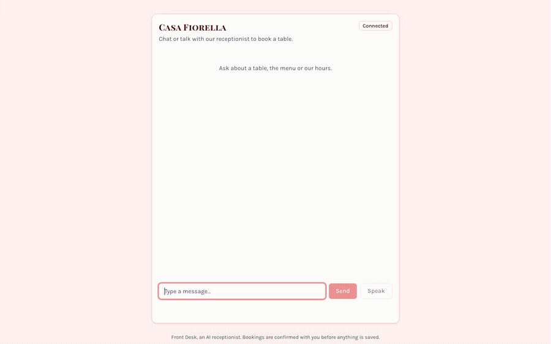
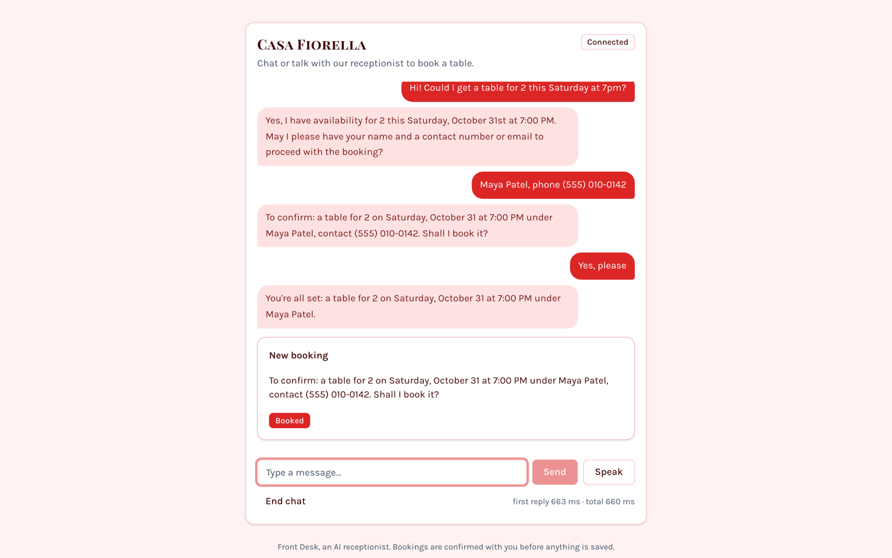
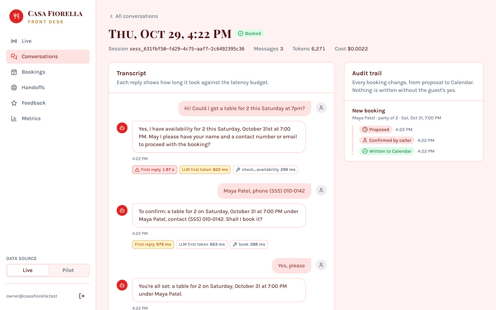
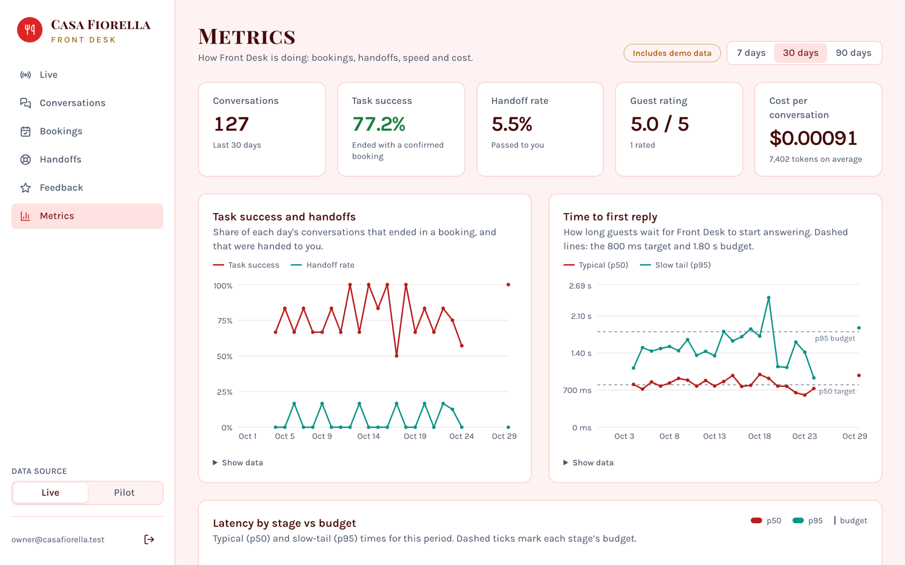
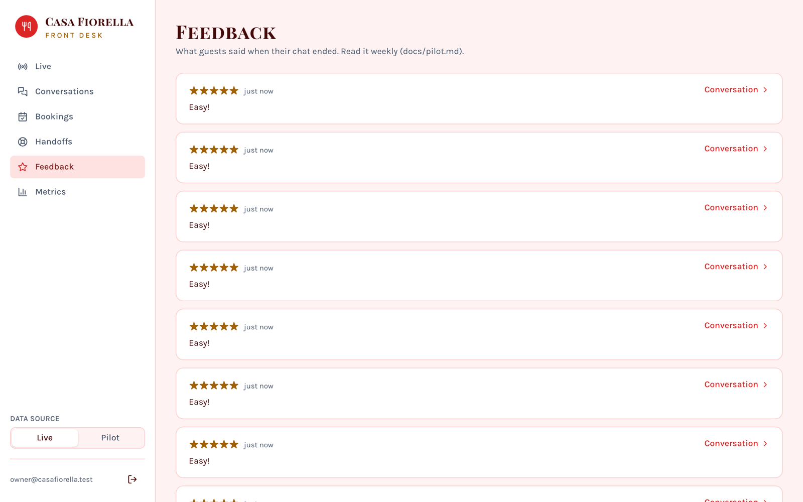

# Front Desk

**An AI receptionist that books real restaurant tables, and never writes to the calendar without the guest's explicit "yes".**

Guests chat or talk to it in the browser. It checks availability, books, reschedules and cancels reservations in Google Calendar, emails a confirmation, and hands off to a human when it's unsure. The demo business is **Casa Fiorella**, a fictional family trattoria. Everything runs on free tiers ($0).



<sub>A real run: Gemini on the free tier, a real Google Calendar event, recorded with Playwright. [Full video (mp4)](docs/media/demo.mp4)</sub>

## Highlights

- **Code-enforced confirmation.** The model can only _propose_ a booking. A separate gate reads it back, waits for the guest's yes, re-checks the slot under a lock, and only then writes to Calendar. A test walks every 2-step message sequence, and no write is ever reachable without a confirm.
- **Evaluated like a product:** 100 scripted-caller scenarios across 11 categories (bookings, reschedules, prompt injection, angry callers, policy edge cases).
  - **95.0%** task success
  - **97.0%** correct handoffs
  - **0** unsafe actions

  CI replays them with no API keys and fails on any regression.

- **Owner dashboard.** Live conversations, transcripts with per-turn latency against a budget, an append-only audit trail, bookings, a handoff queue with outcomes, guest feedback and metrics. Real pilot data is kept apart from demo and eval data.
- **Voice.** Browser speech-to-text and text-to-speech, sentence streaming and barge-in.
- **Built for strangers:**
  - per-IP and per-session rate limits, and a Cloudflare Turnstile bot check
  - booking and email caps that `+tags` can't dodge
  - a 30-day retention job that redacts personal data
  - no personal data in logs (tested)
  - a production guard that refuses any paid setting
- **$0 to run:** Gemini free tier with a hard spend cap of 0, and an Oracle Always Free VM behind Caddy (automatic HTTPS).

| Guest chat                                                    | Owner: one conversation, its latency and audit trail                              |
| ------------------------------------------------------------- | --------------------------------------------------------------------------------- |
|  |  |
| **Owner: metrics**                                            | **Owner: guest feedback**                                                         |
|      |                             |

## How it's built

```
Browser (/talk: chat + voice) ──WebSocket──▶ api (Fastify) ──▶ core: agent loop, gate, guardrails
Browser (/dashboard: owner) ──▶ web (Next.js) ──▶ api /owner/*        │
                                                     Gemini (free) ◀───┤──▶ Google Calendar (source of truth)
                                    Postgres: conversations, audit ◀───┤
                                 Redis: sessions, limits, job queue ◀───┘──▶ worker ──▶ Gmail confirmations
```

- **Design:** [docs/superpowers/specs/2026-10-22-frontdesk-design.md](docs/superpowers/specs/2026-10-22-frontdesk-design.md).
- **Learning notes:** one per milestone, with reading order, concepts and a quiz, in [docs/learning/](docs/learning/).

## Prerequisites

- Node 24 (`.nvmrc`)
- pnpm 10, via `corepack enable`
- Docker (for Postgres and Redis)

## Quickstart

```bash
pnpm install
cp .env.example .env
pnpm infra:up      # postgres on :54320, redis on :63790
pnpm verify        # lint, format check, typecheck, unit tests (no Docker needed)
pnpm test:infra    # smoke tests against the running containers
```

Host ports are non-standard on purpose so they don't clash with a local Postgres or Redis. Change `POSTGRES_PORT` / `REDIS_PORT` and the URLs in `.env` if you need different ones.

If `frontdesk_eval` is reported missing, your Postgres volume predates the init script. Recreate it with `docker compose down -v && pnpm infra:up` (this deletes local data).

## Workspace

| Path                    | Purpose                                                                                                        |
| ----------------------- | -------------------------------------------------------------------------------------------------------------- |
| `apps/api`              | Fastify: WebSocket sessions, agent loop host, owner REST + live feed                                           |
| `apps/worker`           | BullMQ jobs: confirmation emails, retries, metric rollups                                                      |
| `packages/core`         | Pure domain: config, availability, agent loop, tools, confirmation gate, guardrails. No I/O (enforced by lint) |
| `packages/llm`          | LLM provider interface, providers, and cache / rate-limit / retry / spend-cap wrappers                         |
| `packages/integrations` | Google Calendar and Gmail adapters                                                                             |
| `packages/db`           | Drizzle schema and migrations                                                                                  |
| `packages/evals`        | Scenario simulator, scorer, `pnpm eval` scoreboard                                                             |

`apps/web` is the Next.js caller widget (`/talk`) and owner dashboard (`/dashboard`).

## Pilot and deploy

Front Desk is ready to run as a public pilot on an Oracle Cloud Always Free VM behind Caddy (automatic HTTPS), at $0. The production stack (`deploy/compose.prod.yml`) has been built and run end to end; going live is waiting on Oracle free-tier capacity. See:

- [docs/deploy.md](docs/deploy.md): setup and deploys
- [docs/pilot.md](docs/pilot.md): the weekly routine, and comparing real numbers with the evals
- `pnpm release`: tags the weekly `vYYYY.MM.DD` release
- `pnpm smoke <url>`: checks a deployed site without spending any LLM quota
